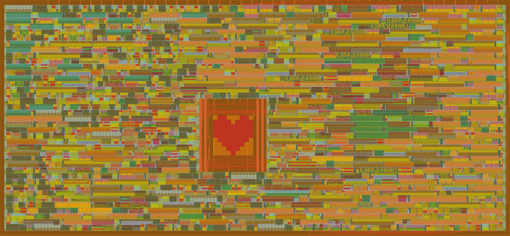
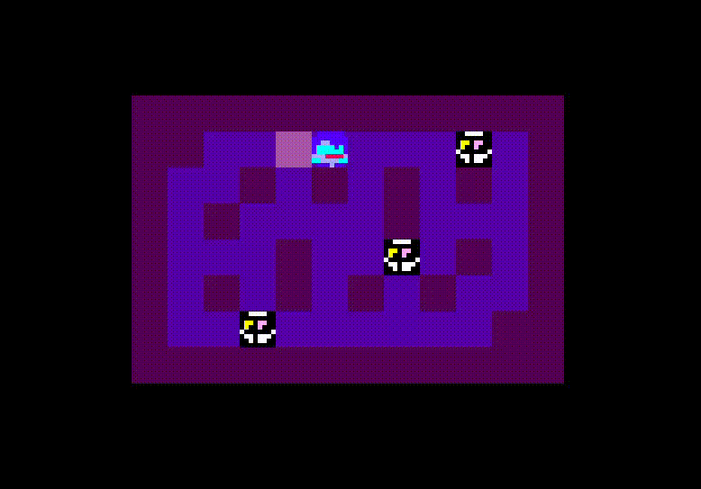

   

# walking simulator ft. IMAGE_FRIEND (Deltarune ch. 3)

### what is this

i made this thing in vga playground, its a recreation of the eram fight in deltarune but like eram is not there. basically all you can do is just move around in the map and 'stab' enemies. its very cool.

[Read the documentation for project](docs/info.md)  
[Read about how I made this project](https://candyisakat.dev/eram)

### preview of how it looks like

